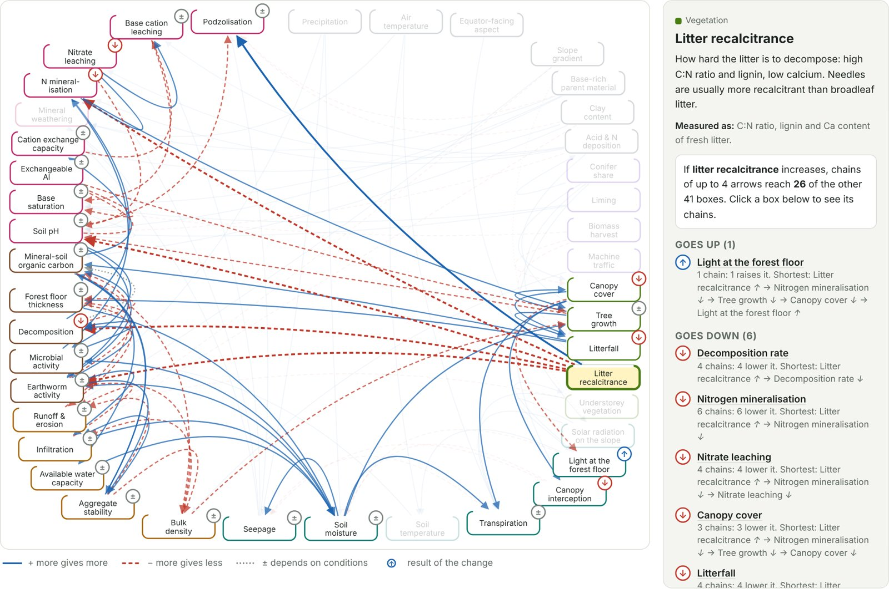

# Soil–Forest Cause–Effect Map

An interactive map of how climate, topography, trees, management and soil properties affect each other in temperate forests. Pick any factor and follow a change along every chain of arrows, find what drives it, trace the routes between two factors, or list the feedback loops. Every arrow has a short mechanism and published sources.

**Open the map:** https://amatulifa.github.io/soil-forest-cause-effect-map/ *(change this link if your repository has another name)*



## What is in it

- **42 boxes** in 7 categories: site and climate, management, vegetation, radiation and water, soil structure, soil life and organic matter, soil chemistry.
- **110 arrows**, each with a sign (+, − or “depends on conditions”), the mechanism in one or two sentences, where it holds, and its sources.
- **33 sources**: textbooks and review papers in soil science, forest ecology and microclimate.

## What you can do with it

| Tool | What it shows |
|---|---|
| **Effects** | Follows an increase or decrease of the chosen box along every chain and marks each box it reaches: ↑ all chains raise it, ↓ all lower it, ± they disagree. When chains disagree, it says which way the most direct ones point. |
| **Causes** | Everything that raises or lowers the chosen box, directly or through chains. |
| **Direct arrows** | Only the arrows into and out of the box, with mechanisms and sources. |
| **Trace** | Every chain between two boxes, with the reasoning behind each step. |
| **Feedback loops** | Chains that return to their start: reinforcing (R) or balancing (B). |
| **Longest chain** | How many arrows a chain may have (3–8, default 4). |
| **Categories** | Hide a category to simplify the map; hidden boxes are also left out of every chain. |
| **Copy link** | The address keeps the current view, so a link opens exactly what you see. |
| **Download SVG** | The current view as a vector picture for slides or papers. |
| **All arrows** | A searchable table of every arrow with its mechanism and sources. |

Light and dark mode, keyboard navigation and phones are supported.

### Links to a view

The part of the address after `#` stores the view, so you can link straight to it:

| Example | Opens |
|---|---|
| `#box=ph&view=causes` | what raises and lowers soil pH |
| `#box=con&view=effects&dir=down` | effects of fewer conifers |
| `#trace=dep,ewm` | every chain from acid deposition to earthworms |
| `#arrow=lrc,ewm` | one arrow with its sources |
| `#loops&depth=6` | feedback loops of up to 6 arrows |
| `&hide=mgmt,phys` | (added to any of the above) hides categories |

## Reading it, and its limits

- Every box is a quantity that can go up or down. “+” means more of the source gives more of the target, “−” gives less. Signs multiply along a chain: two “−” arrows give a “+”.
- The map shows **directions, not sizes**. When chains disagree, signs alone cannot say which wins; that needs data or a quantitative model. Longer chains are usually weaker, which is why the default is 4 arrows.
- Arrows run on very different time scales: interception within minutes, base saturation over decades, podzolisation over centuries.
- Most arrows hold for temperate and boreal forests on mineral soils; conditions are given where they matter. Peat soils, fire and groundwater-affected soils are not covered.
- It is a tool to think through a question, plan measurements and explain results, not a simulation model.

## Adding or changing boxes and arrows

Everything is in **one file: `data/network.js`**. The map, all tools and both tables are built from it, so a new entry appears everywhere at once. No build step is needed: edit, commit, reload.

A box:

```js
{ id: 'ewm', cat: 'bio', label: 'Earthworm|activity', name: 'Earthworm activity',
  d: 'What it is and why it matters.',
  m: 'How it is usually measured.' }
```

- `id`: short code, letters only, unique. `cat`: one of the category ids at the top of the file.
- `label`: text in the box; `|` starts a second line. `name`: full name, read as “more …”.
- The order of the list is the order around the ring (clockwise from the top), so keep a category together.

An arrow:

```js
{ f: 'ph', t: 'ewm', s: '+', r: ['reich', 'ponge'],
  n: 'Most earthworms avoid soils below about pH 4.5.',
  c: 'Optional: where or when it holds.' }
```

- `f` and `t`: the ids of the two boxes. `s`: `'+'`, `'-'` or `'0'` (depends on conditions).
- `n`: the mechanism. `r`: keys of the sources in the `refs` list at the end of the file.

A mistake (an unknown id, sign or source key) does not break the page: the entry is skipped and a warning appears in the browser console (F12).

Suggestions and corrections with a source are welcome as an issue or a pull request.

## Files

```
soil-forest-cause-effect-map/
├── index.html              the page
├── data/network.js         boxes, arrows and sources (edit this)
├── assets/js/app.js        drawing and tools
├── assets/css/style.css    styles for light and dark mode
├── docs/screenshot.jpg     picture for this README
├── .nojekyll               tells GitHub Pages to serve the files as they are
├── LICENSE                 MIT licence for the code
└── README.md
```

Plain HTML, CSS and JavaScript with no libraries, no build step and nothing loaded from other servers. To run it locally, open `index.html` in a browser.

## Publish on GitHub Pages

1. On github.com, create a new **public** repository named `soil-forest-cause-effect-map`, **without** a README, licence or .gitignore (this folder already has them).
2. In the Mac Terminal:
   ```
   cd ~/Downloads/soil-forest-cause-effect-map
   git init
   git add .
   git commit -m "Soil–Forest Cause–Effect Map"
   git branch -M main
   git remote add origin https://github.com/amatulifa/soil-forest-cause-effect-map.git
   git push -u origin main
   ```
3. On GitHub: **Settings → Pages → Build and deployment → Source: Deploy from a branch, Branch: main, / (root) → Save**.
4. After a minute or two the map is live at `https://waleedsoil.github.io/soil-forest-cause-effect-map/`.

If a red bar at the top of the page says that files did not load, a folder is missing from the repository. Check that `assets` and `data` were pushed, then reload with Cmd+Shift+R.

## Licence and citation

- Code (`index.html`, `assets/`): [MIT](LICENSE).
- Content (the boxes, arrows and texts in `data/network.js`): [CC BY 4.0](https://creativecommons.org/licenses/by/4.0/). Reuse it freely with credit.

> Ramzan, W. (2026). Soil–Forest Cause–Effect Map: an interactive map of causes and effects in temperate forest soils. https://amatulifa.github.io/soil-forest-cause-effect-map/

## Credits

Created by Waleed Ramzan (Design and Initial Idea) & Amatul Jameel (Review, Hosting and Management). It grew out of a group project in the Landscape Ecology Project Seminar 2026/27 at the University of Göttingen. The ring layout follows Mulder’s chart of nutrient interactions.
